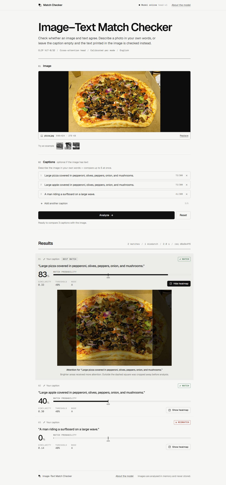
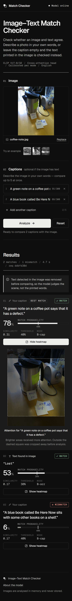

# Image–Text Match Checker

Upload an image and optionally up to 5 captions. The app reports whether each text **matches** the image, with a calibrated probability, the raw CLIP similarity and an attention heatmap. If the image contains printed text, it is detected with OCR, masked out of the image, and checked as an extra row ("Text found in image").

The app only runs inference. All model logic comes from `backend/model_outputs/mismatch_core.py`, the same file the training notebook used, and the API reproduces the notebook's golden predictions exactly (Δ probability = 0.000000 on every golden case).

```
Browser ──► Nginx (frontend container, :80) ──/api/*──► FastAPI (backend container, :8000, internal)
            serves the built React app                   CLIP ViT-B/32 + EasyOCR + cross-attention head
```

## Run with Docker

```bash
docker compose up --build
```

Then open http://localhost. The compose project is `mismatch`; containers are `mismatch-backend` and `mismatch-frontend` (e.g. `docker logs -f mismatch-backend`). The first build downloads the CPU PyTorch wheels, CLIP and the EasyOCR English models into the image, so the running containers never need the internet. The backend becomes healthy once the models are loaded and a warm-up prediction has run; the frontend starts after that.

Hardening: the backend runs as a non-root user with a read-only root filesystem (only `/tmp` is writable, in RAM), and uploads are parsed fully in memory, so no uploaded image can be written to disk.

## Local development (no Docker)

Backend (Python 3.12):

```bash
cd backend
python -m venv .venv && .venv/Scripts/activate   # or: source .venv/bin/activate
pip install torch==2.10.0 torchvision==0.25.0 --index-url https://download.pytorch.org/whl/cpu
pip install -r requirements.txt
uvicorn app.main:app --reload
```

Frontend (Node 20+), in a second terminal:

```bash
cd frontend
npm install
npm run dev
```

Open http://localhost:5173. Vite proxies `/api` to `http://localhost:8000` (override with `API_PROXY_TARGET`).

## Tests

```bash
cd backend
python scripts/golden_check.py      # Predictor vs golden_predictions.json, no API
python -m pytest -q                 # 7 golden tests + 12 spec API tests + edge cases
```

Inside the running stack: `docker compose exec backend python -m pytest -q -p no:cacheprovider`.

End to end, against the running Docker stack through Nginx (static app, golden set, all 12 spec scenarios, latency):

```bash
python e2e/check_stack.py http://localhost
```

## API

| Method | Path | Purpose |
|---|---|---|
| `POST` | `/api/predict` | `multipart/form-data`: `image` (JPEG/PNG/WebP, ≤ 10 MB, ≤ 40 MP) + 0–5 repeated `captions` |
| `GET` | `/api/health` | `200 {"status":"ok","model_loaded":true}` when ready, `503 {"status":"loading"}` while loading |
| `GET` | `/api/model-info` | Model name/version, headline test metrics, thresholds, limitations |

Interactive docs: `/api/docs`. Errors are always `{"error": {"code", "message"}}` with the codes from spec §7.4 (`MISSING_IMAGE`, `TOO_MANY_CAPTIONS`, `CAPTION_TOO_LONG`, `FILE_TOO_LARGE`, `UNSUPPORTED_FILE_TYPE`, `NO_TEXT_INPUT`, `INFERENCE_FAILED`, `MODEL_NOT_READY`).

Decision logic: OCR always runs. If text is found (confidence ≥ `ocr.min_conf`, ≥ `ocr.min_chars` alphanumerics, both from `config.json`) the text regions are inpainted, user captions are scored in mode `B-cap` and the OCR text in mode `B-ocr`; otherwise captions use mode `A`. No captions and no text → `422 NO_TEXT_INPUT`.

## Configuration

| Variable | Default | Used by |
|---|---|---|
| `MODEL_DIR` | `./model_outputs` | Backend |
| `MAX_UPLOAD_MB` | `10` | Backend |
| `MAX_CAPTIONS` | `5` | Backend |
| `MAX_CAPTION_CHARS` | `300` | Backend |
| `TORCH_THREADS` | min(CPU cores available to the container, 4) — more threads stall EasyOCR on shared VMs | Backend |
| `HF_HOME` | `/models/hf` | Backend image (CLIP cache) |
| `EASYOCR_MODULE_PATH` | `/models/easyocr` | Backend image (OCR models) |
| `VITE_API_BASE` | `/api` | Frontend build |

## Repository layout

```
backend/
  app/            main.py (routes, startup), service.py (validation + Predictor), multipart.py (in-memory
                  upload parsing), config.py, errors.py, schemas.py
  model_outputs/  artifacts from the training notebook (do not edit)
  scripts/        golden_check.py, latency.py, download_models.py (Docker build step)
  tests/          test_golden.py, test_api.py
frontend/
  src/            App.jsx, api.js, components/ (ImageDropzone, CaptionList, AnalyzeButton, ResultCard,
                  HeatmapOverlay, ErrorBanner, ModelInfoModal, StatusPill), styles.css
  public/examples three golden images offered as one-click examples
  nginx.conf, Dockerfile
docker-compose.yml
```

## Measurements

Measured on the Docker stack through Nginx, with the backend limited to the spec's target machine by `docker-compose.yml` (`cpus: 4`, `mem_limit: 3g`), 20 runs per case (`python e2e/check_stack.py`):

| Metric | Target (spec §7.6) | Measured |
|---|---|---|
| Startup (model load + warm-up) | ≤ 60 s | 14 s |
| p50 latency, 1 caption | ≤ 2 s | 1.36 s (p95 1.57 s) |
| p95 latency, 5 captions + OCR | ≤ 4 s | 3.73 s (p50 3.47 s) |
| Backend memory (RSS) | ≤ 3 GB | 0.81 GB |
| Golden predictions via the full stack | ±0.01 | max \|Δp\| = 0.000001, all verdicts identical |
| Files written by the backend during requests | none | none (`docker diff` empty) |

How the OCR-bound latency was brought under target without changing any output (`mismatch_core.py` untouched; golden text, boxes and probabilities identical):

- EasyOCR's CRAFT detector runs with channels-last memory layout, its BatchNorms folded into the convolutions, and denormal flushing (≈ 6.7 s → 3.5 s per text image).
- `TORCH_THREADS` defaults to `min(cores, 4)`: more threads gave no speedup, and 18 OpenMP threads on a shared Docker VM stalled a request for minutes.
- Tried and rejected: `fx.optimize_for_inference` (faster but changes OCR output), ONNX Runtime (+11%, not worth a new dependency), jemalloc (no measurable gain).

Very text-dense images (e.g. a full web-page screenshot with ~70 text boxes) still take longer, because EasyOCR recognises every box.


## Manual UI checklist (spec §11.3)

- [x] Drag-and-drop, click-to-select (real file chooser) and paste all load an image
- [x] Add and remove caption boxes; a 6th box is not allowed
- [x] Analyze stays disabled with no image
- [x] Error messages from §8.5 appear (wrong type, > 10 MB, no text input, network)
- [x] Heatmap aligns with the preview at 1280 px and 360 px widths (canvas and image boxes match exactly)
- [x] Layout per §8.1: single centred column, max width 900 px; result cards stacked, heatmap drawn over the image inside each card
- [x] Reset clears the image, captions and results, and returns focus to the dropzone
- [x] Keyboard: dropzone is focusable and opens on Enter/Space; Enter in a caption submits
- [x] No console errors; results region is `aria-live="polite"`; light and dark themes



